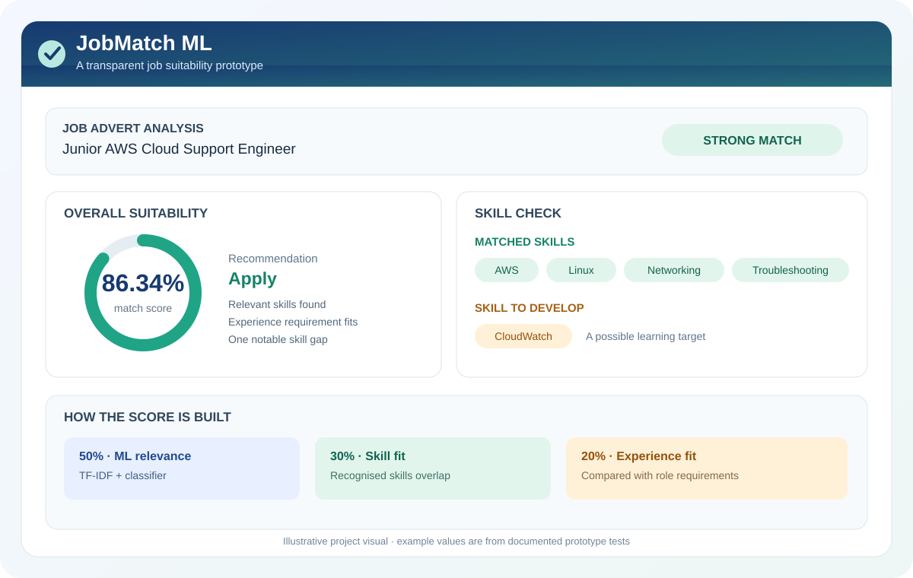
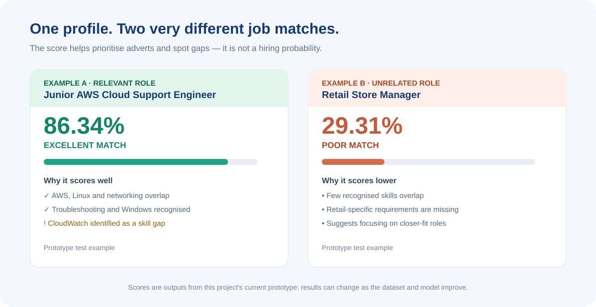

# JobMatch ML

**An explainable machine-learning prototype that helps a job seeker prioritise adverts, compare required skills with their profile, and identify useful learning gaps.**

[View the repository](https://github.com/Jazblue/job-match-ml) · [Download the project as a ZIP](https://github.com/Jazblue/job-match-ml/archive/refs/heads/master.zip)



## What does the ML do?

JobMatch ML takes a candidate profile and a job advert, then estimates how closely the role fits the candidate. It is designed to make the reasoning easier to inspect rather than returning a score with no explanation.

1. **Reads job-advert text.** The web app can accept a pasted advert. Rule-based text processing looks for a job title, recognised skills and experience requirements.
2. **Measures text relevance.** A scikit-learn pipeline uses TF-IDF to turn text into numerical features and a Logistic Regression classifier to estimate relevance based on the labelled examples it was trained on.
3. **Checks skills.** The app compares recognised advert requirements with skills in the candidate profile and highlights matches and gaps.
4. **Checks experience fit.** The app estimates how well the candidate's experience level fits the role's stated requirement.
5. **Combines the signals.** The current prototype combines ML relevance (50%), skill compatibility (30%) and experience fit (20%) into one overall suitability score.
6. **Explains the result.** It displays the score, a match category, recognised matching skills, possible missing skills and a recommendation to help prioritise further research.

## Example results

These are documented functional-test examples from the current prototype, not guarantees of real-world performance.



| Test advert | Suitability score | Prototype result |
|---|---:|---|
| Junior AWS Cloud Support Engineer | 86.34% | Excellent match |
| Retail Store Manager | 29.31% | Poor match |

For the cloud-support example, the prototype recognised AWS, Linux, networking, troubleshooting and Windows, and identified CloudWatch as a possible skill gap. For the retail example, it found no recognised skill overlap and returned a lower score.

## How the scoring works

- **50% — ML relevance:** text-based relevance estimated by the trained TF-IDF and Logistic Regression pipeline.
- **30% — Skill compatibility:** overlap between recognised job requirements and the candidate's listed skills.
- **20% — Experience fit:** an estimate of how the candidate's experience level compares with the role requirement.

These weights describe the current prototype's scoring design. The final percentage is a **suitability estimate, not a probability of being hired, an employer decision, or a guarantee that an application will succeed**.

## Technology

- Python 3.14
- Flask web application
- scikit-learn: TF-IDF text features and Logistic Regression
- pandas and NumPy for dataset handling
- joblib for saving and loading the trained pipeline
- Gunicorn for production-style WSGI serving

## Run it locally

### 1. Download or clone

Download the ZIP using the link at the top, or clone the repository:

```bash
git clone https://github.com/Jazblue/job-match-ml.git
cd job-match-ml
```

### 2. Create a virtual environment

Windows PowerShell:

```powershell
python -m venv .venv
.\.venv\Scripts\Activate.ps1
python -m pip install -r requirements.txt
```

Linux or macOS:

```bash
python3 -m venv .venv
source .venv/bin/activate
python -m pip install -r requirements.txt
```

### 3. Start the web application

```bash
python src/app.py
```

Open [http://127.0.0.1:5000](http://127.0.0.1:5000) in your browser.

## Repository contents

- `src/app.py` — Flask web application and advert analysis
- `src/train_model.py` — training and evaluation pipeline
- `src/predict_job.py` — command-line prediction workflow
- `src/add_jobs.py` — helper for expanding the sample job dataset
- `data/jobs.csv` — labelled job examples for development
- `data/candidate.json` — sample candidate profile
- `data/job.json` — sample job input
- `models/jobmatch_model.joblib` — saved model pipeline
- `docs/images/` — project visuals used in this README

## Limitations and responsible use

- The training dataset is small and manually assembled; it does not represent the full job market.
- Advert extraction relies on a predefined set of recognised skills and text patterns. Unusual wording or an unrecognised skill may be missed.
- Results depend on the quality of the candidate profile, advert text, training examples and current scoring rules.
- Evaluation results on a small curated dataset should be treated as experimental, not as proof of general performance on unseen real-world adverts.
- A low score does not mean a person cannot do a job, and a high score does not mean an employer will interview or hire them.
- Review the original advert and requirements yourself. Use this tool as a decision-support and learning aid, not as an automated hiring decision.

## Project status

This is an actively developed portfolio project. The current focus is on making the scoring explainable, testing pasted job adverts, improving skill recognition and documenting the model's limitations before any public hosted demo is considered.
